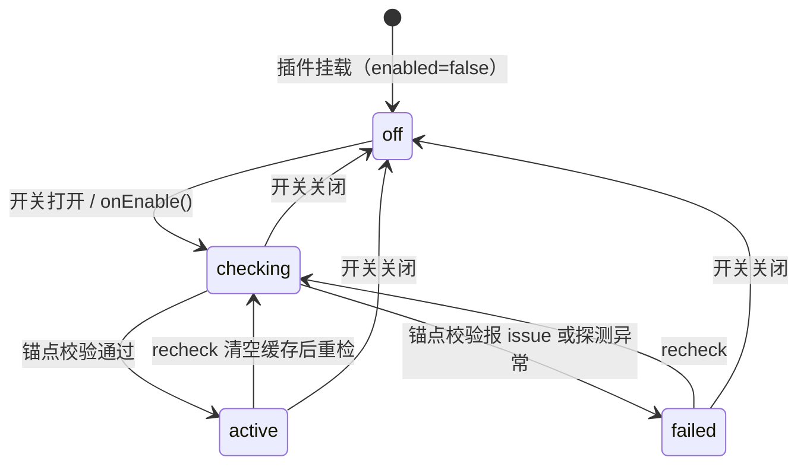

# dsh-unrestricted 模块设计

## 职责与边界

负责：在系统提示词装配的瀑布链上，为当前预设注入一份「无限制本地执行把契约」，
并在用户关闭开关时把提示词恢复成未安装本插件时的字节；同时提供设置页与输入框两处
开关界面、每个预设的可用性状态与融合后提示词的预览。

不负责：
- 不实现任何工具、沙箱或模型调用——规则只影响"交付内容"，不改变调用机制；
- 不改写宿主的预设定义（`agentPresets` 的注册内容）——本插件只在装配结果上做增补，
  唯一的例外是 Minimal 的 persona 影子，它在 agent 作用域注册同名 section 以覆盖
  上游 persona 前缀；
- 不持久化用户选择——开关状态由 profile 的 Loader 组合（`config.enabled`）持有，
  本插件只读取；
- 不向上游仓库提交任何改动（见 [fork 策略](fork-policy.md)）。

## 依赖关系

- 依赖宿主服务：`settings`（声明本插件无自有设置项）、`systemPrompt`（装配与渲染）、
  `loader`（等待组合就绪、监听 `loader/volatile-update`）、`connection`（可选的
  Web RPC 通道）、`agentPresets`（可选：预设枚举与组合名解析）。
- 依赖宿主包：`@deepseek-ai/schemastery`（Config 校验）、
  `@deepseek-ai/dsh-system-prompt`（`renderPrompt`，缺失时用内置 `fallbackRender`）、
  `@deepseek-ai/dsh-scope`（`createScope`，用于租约不可用时的临时作用域）。
  解析失败不抛错，由 `src/host.js` 的 `loadHost()` 返回 `undefined` 并降级。
- 被依赖：无。本插件是叶节点，其他模块不消费它的导出。
- 跨模块改动路由：动到浏览器注册点（slot 名/顺序）先读 `docs/design.md` 的
  「对外接口」；动到融合块文案先读 [prompt-fusion](prompt-fusion.md)。

## 核心数据模型

### PresetModeState（生命周期型）

每个预设一份，描述它在当前开关状态下的可用性。

- 属性：`state ∈ {off, checking, active, failed}`、`issues: string[]`、
  `name?: string`（来自 `agentPresets.list()`）、`known: boolean`、`broken?: boolean`。
- 状态机：

- 每个状态必须写清"它不是什么"：`off` 不是"已禁用预设"，只是本插件不介入；
  `checking` 不代表即将成功，长时间停留通常意味着 `ctx.loader.await()` 未返回；
  `active` 只表示锚点校验通过，不保证每个 agent 的装配都已融合（子代理可能带
  受限上下文而被拒绝）；`failed` 不是致命错误，装配路径会降级为不融合。
- 迁移唯一入口：`ensureCheck(presetId)`（进入 checking 并写入结果）与
  `handleRpc('recheck')`（清空缓存后重跑）。禁止在其他地方直接写
  `state.startup` / `state.runtime`。

- 不变量：
  - I1: 禁止在 `enabled === false` 时读取或改写任何提示词内容。
  - I2: `issues` 非空时，装配路径必须返回未融合的原始结果。
  - I3: `state.startup` 未含该预设时，其状态必须是 `checking`，不得直接显示 `active`。

### PersonaShadow（句柄型）

Minimal 唯一的覆盖手段：在 agent 作用域注册名为 `deployment:persona-prefix` 的
完整 section，并持有其 disposer。

- 属性：`agent`（WeakMap 键）、`dispose`（注册函数返回）、`state.customMinimal`
  标记（调用方已注册同名 section、注册被拒绝的 agent）。
- 状态机：`opened → disposed`。只有两种终态：释放、或随 agent 销毁自动失效。
- 迁移唯一入口：`syncMinimalShadow(agent)` 注册，`unshadowMinimal(agent)` 释放。
  禁止绕过它们直接调用 `dispose()`。
- 不变量：
  - I4: 一个 agent 至多持有一个影子，且只在 `enabled` 且预设为 `minimal` 且
    `state.fusedMinimal !== null` 时存在。
  - I5: 注册抛出的错误信息恰为
    `prompt section "deployment:persona-prefix" is already registered in this scope`
    时，必须转入 `customMinimal` 路径而不是向上抛错；其他错误必须继续上抛。

### FusionResult（不可变值对象）

`fuseSections(sections, presetId, { isSubagent })` 的返回值。

- 属性：`sections`（替换后的完整 section 列表，保持顺序与 `order`）、
  `issues?: string[]`（锚点缺失或内容被改动的说明）。
- 不变量：
  - I6: 返回 `issues` 时不得同时返回可用的 `sections`；调用方看到 `issues`
    就必须放弃融合。
  - I7: 融合只增删两类 section——插入 `unrestricted:execution-mode`
    与 minimal 的 persona 前缀改写；其余 section 的 `text` 必须逐字保留。

### PreviewEntry（不可变值对象 + 请求代次）

设置页「切换前先看」的载荷：`{ presetId, contract, available, reason?, source?,
text?, bytes?, lines? }`。

- 属性：`source` 为 `live`（来自真实顶层装配的缓存字节）或 `standing`
  （来自标准作用域探测，`{{model}}` / `{{cwd}}` 可能保持字面量）。
- 不变量：
  - I8: 迟到的旧请求结果不得覆盖更新的结果；不同预设的结果互不覆盖。
  - I9: 预览必须只读——不得写入 `state.fusedText`、不得触发开关状态变化。

## 对外接口

- 宿主 RPC 通道 `RPC_CHANNEL`（见 `src/node.js`），端点：
  - `status` → `{ enabled, contract, modes }`，开关打开时会先跑一遍校验；
  - `preview` → `{ presetId }`，接受 `{ args: { presetId } }` 包裹形式；
  - `recheck` → 清空缓存并重跑校验，返回与 `status` 相同的载荷。
  未知名返回 `{ ok: false, error: { code: 'internal', ... } }`，不抛异常。
- 浏览器插槽注册（`src/client/index.tsx`）：
  - `settings.section` / id `unrestricted` / order 16；
  - `conversation.input.left` / id `unrestricted-toggle` / order 20。
  两处消费同一个 `controller.face()`，因此两处显示的开关状态不会分叉。
- 语言键命名空间 `settings.unrestricted`，字典在 `src/client/locales.ts`
  （zh / en 两份，ja 由 README 面向读者，不参与界面）。新增文案必须两种语言同时补齐。

## 非功能红线

1. **装配路径绝不抛错穿透**：瀑布监听内的任何异常都必须吞掉并返回原始装配结果
   （来源：issue-7 装配失败事故，见 [issue 7 排查记录](issue-7-recovery.md)）。载体：
   [评] 对抗评审判据 = 对 `system-prompt/assemble` 注入畸形 `agent` / 缺失服务，
   观察是否仍返回原装配。
2. **校验惰性化**：开关打开时只强制校验 `minimal`，其余预设按需校验，避免一个
   预设的挂载失败拖住全部（来源：Minimal 影子必须在首个请求前就位）。
3. **装配路径不做 IO**：除 `ctx.loader.await()` 与只读服务查询外，不得在瀑布内
   发生文件或网络访问（来源：装配在请求热路径上）。
4. **开启态无宿主自带设置项**：`ctx.settings.configure({ auto: false })` 必须在
   `apply` 内声明，否则宿主会为本插件生成空设置页（来源：设置页归属约定）。
5. **三语言外显一致**：README / 界面文案变更时三种语言同批修改，不允许只改中文
   （来源：上游 v0.2.4 的三语言复核要求）。载体：[人] 见
   [testing-guide](testing-guide.md) 的人工 review 项。

## For Agents

- 动手前先读：`docs/design.md`（本节与不变量）→ 改规则读 `src/rules.js` 与
  [prompt-fusion](prompt-fusion.md) → 改界面读 `src/client/controller.ts`。
- 绝不做：手改 `lib/client.js`；向上游推送；在瀑布里抛出未捕获异常；
  在没有更新 `tests/fixtures/*` 的情况下改锚点。
- 停止并升级人类：需要改锚点常量（`ANCHORS`）含义、需要新增对外 RPC 端点、
  需要改变开关持久化位置、或上游改动与本 fork 的界面归属发生结构性冲突时。

## 测试与验证

用例、迁移矩阵与人工 review 项见 [testing-guide](testing-guide.md)；不在此复制。
